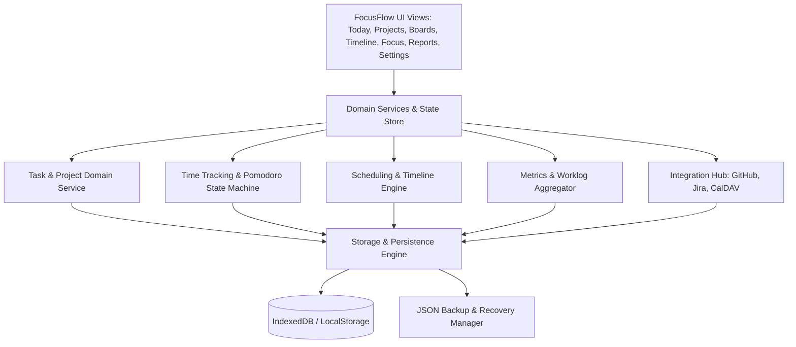

# FocusFlow — System Architecture & Design Specification

## 1. Architectural Philosophy
FocusFlow is engineered as a **local-first, reactive, modular productivity suite**. It rejects heavy framework overhead in favor of a lean, high-velocity, strictly typed TypeScript stack with zero telemetry, high privacy, instant startup, and deterministic state transitions.

### Key Tenets
1. **Local-First & Offline-Ready**: All data operations write synchronously to the state layer and are automatically persisted to IndexedDB with LocalStorage fallbacks.
2. **Deterministic Time Tracking**: Never rely solely on `setInterval` ticks for wall-clock tracking; derive elapsed time from timestamps (`Date.now() - sessionStart`).
3. **Clean Domain Separation**: Business rules (e.g. mutual exclusivity of scheduling dates, Pomodoro cycle progression, task hierarchy updates) are isolated from UI components in dedicated domain services.
4. **Rich Aesthetics & Polish**: Thoughtful typography (Inter, Outfit), high-contrast accessibility, dark and light modes, smooth transitions, and distinct product identity without generic templates.

---

## 2. Layered Architecture

---

## 3. Core Subsystems

### 3.1 Domain Services & Store
- **Task Store**: Normalized dictionary of tasks, tags, projects, subtasks, and archive.
- **Time Tracking Service**: Manages active task timer, day-based log entries, and session boundaries.
- **Focus Mode Engine**: State machine for Pomodoro, Flowtime, and Countdown modes with break triggers.
- **Board Engine**: Categorizes tasks dynamically into Kanban and Eisenhower Matrix views.
- **Schedule Engine**: Maps tasks with `dueWithTime` and planned durations onto a 24-hour visual schedule grid.
- **Integrations Engine**: Manages external issue synchronization protocols with token isolation.

### 3.2 Storage & Backup Layer
- Handles auto-saving state with debounce.
- Full backup export/import conforming to the validated JSON schema.
- Built-in schema validation and fallback recovery.
